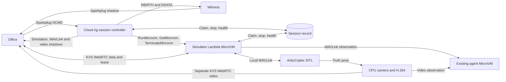

# On-demand virtual quadcopter

An Office operator selects an enlisted `virtual-quad`, starts a disposable session, acquires control, flies ArduCopter SITL using live onboard video, lands, and stops the session. The session starts from a fixed world and aircraft state. The existing cloud agent joins each ready session as a read-only observer.

## Architecture

Run one Linux ARM64 Lambda MicroVM per session. A short-lived Go Lambda controls reservations, starts and stops MicroVMs, and reports lifecycle. The MicroVM runs ArduCopter SITL, a Go supervisor, the shared C++ KVS transport, and a software camera and H.264 encoder.

The milestone covers human flight from Office and read-only agent observation. AI inference, memory, autonomy, return home, ROS, `cmd_vel`, persistent worlds, photorealism, and GPU or robotics-simulator infrastructure are out of scope.

## Hosting decision and qualification

Use AWS Lambda MicroVMs, the service already used by the cloud agent. Each session gets a new VM restored from a dedicated, versioned simulator image in Frankfurt (`eu-central-1`). Start with the 2 vCPU / 4 GiB baseline. The controller uses `RunMicrovm` and `TerminateMicrovm`, and sets a platform maximum duration for every launch. Keep the controller as a short-lived Lambda function. [MicroVM lifecycle](https://docs.aws.amazon.com/lambda/latest/dg/microvms-launching.html) · [Image sizing and builds](https://docs.aws.amazon.com/lambda/latest/dg/microvms-images.html) · [Agent cloud operation](components/agent.md#cloud-operation)

Use managed Internet egress and the `NO_INGRESS` connector. Office and the observer connect through KVS. Disable automatic idle suspension and resumption by omitting the idle policy. The simulator uses its own scoped execution role, MicroVM image, and logs. Both roles and the image remain separate from the observer's. The agent's live acceptance established KVS observation of both streams from MicroVMs in Frankfurt. Qualify both KVS masters from the simulator VM, including the selected ICE candidate pairs, forced TURN and joins across the five-minute TURN credential and ten-minute signaling idle windows. [MicroVM networking](https://docs.aws.amazon.com/lambda/latest/dg/microvms-networking.html) · [Agent acceptance](history/acceptance/agent-cloud.md) · [KVS signaling quotas](https://docs.aws.amazon.com/kinesisvideostreams-webrtc-dg/latest/devguide/kvswebrtc-limits.html)

The snapshot contains packaged binaries and an idle lifecycle hook listener. The `/run` hook checks the session assignment before creating fresh scratch, obtaining workload credentials, and starting SITL and both KVS masters. Keep credentials, live sockets and session identity out of the snapshot. Record three cold starts, resource use, real-time simulation speed, sustained browser decode, and terminal VM state after Stop with an unresponsive supervisor or hook. Test the hosting deadline separately. The local ARM64 smoke test establishes packaging and process behavior on Linux. The MicroVM snapshot, networking, and termination budgets still need live AWS evidence. [Snapshot compatibility](https://docs.aws.amazon.com/lambda/latest/dg/microvms-images-snapshots.html) · [Qualification and Fargate cleanup](../devices/virtual-quad/qualification/README.md)

## Flight dynamics and camera

- Launch ArduCopter's built-in quad dynamics at real-time speed with a fixed home, heading, initial parameter file, and freshly initialized EEPROM and scratch directory. ArduCopter owns the simulated motor, attitude, navigation, sensor and ground-contact behavior. Start level, disarmed, on a flat landing pad. The floor matches the SITL ground plane. Painted walls, pillars and markers are visible scene geometry and can be flown through. SITL ground contact is the only scene interaction in this PoC. [SITL usage](https://ardupilot.org/dev/docs/using-sitl-for-ardupilot-testing.html), [SITL ground model](https://github.com/ArduPilot/ardupilot/blob/master/libraries/SITL/SIM_Aircraft.cpp)
- Render a fixed set of colored surfaces on the CPU with a perspective camera. Use a patterned floor, distinct directional wall markings, a landing pad and a few recognizable landmarks. A simple ray caster over planes and boxes is sufficient. Put the walls well outside the demonstration maneuvers. Keep the aircraft dynamics, MAVLink IO, encoding and per-viewer sends independent so a slow encoder or peer cannot pause flight.
- Request MAVLink 2 `SIM_STATE` at 25–30 Hz on the private SITL connection. The upstream message contains the truth quaternion, altitude and integer latitude/longitude extensions. Convert the integer coordinates relative to the fixed home to local north/east/down in metres, using the same altitude datum. Rotate a fixed forward-facing camera offset and roughly 15° downward mount from body forward/right/down through the truth attitude into local NED. For a renderer using east/north/up, map `(N,E,D)` to `(E,N,-D)` before constructing the view matrix. Verify cardinal headings, translation, climb, pitch and roll against named landmarks. [ArduPilot SIM_STATE sender](https://github.com/ArduPilot/ardupilot/blob/master/libraries/SITL/SITL.cpp), [MAVLink SIM_STATE](https://mavlink.io/en/messages/common.html#SIM_STATE)
- `SIM_STATE` has no sample timestamp. Stamp each received complete pose with the session monotonic clock, and interpolate position and quaternion from the most recent two samples on a render timeline about one sample behind reception. Use monotonic presentation timestamps from that timeline. Compare separate boot-time telemetry with wall time to detect a stalled or slow simulation. Drop stale samples or frames, and report video unavailable when pose delivery stalls. This bounds practical alignment at real-time speed. [MAVLink common messages](https://mavlink.io/en/messages/common.html#SIM_STATE)
- Target 640 × 360 at 15 fps and roughly 0.6–1.0 Mbps. Feed CPU-rendered frames into a headless GStreamer x264 pipeline. Encode once in constrained baseline compatible with the shared sender's advertised H.264 profile (`42e01f`), with no B-frames, a keyframe at least every second, and SPS/PPS on keyframes. Use the existing encoded access-unit interface and KVS sender. Bound queues and drop old raw frames before encoding. Keep slow viewers from blocking each other and recover at an IDR if a peer falls behind. [Board video contract](components/board-video.md), [Shared sender interfaces](../devices/common/board/kvs_master/include/kvs_master/video_capturer.hpp)

## Device, registry and transport

Add `devices/virtual-quad/` alongside cloud-mcu. Use `virtual-quad` as the type and default device name, and associate it only with existing `cloud` rigs. Declare `sparkplug`, `simulation`, `mavlink`, `video`, and `agent`, with type-owned schemas, defaults and fixtures for those named shadows, and MAVLink and video descriptor/status fixtures. Declare `resources.mavlink.channel_name = "{device_id}-mavlink"` and `resources.board_video.channel_name = "{device_id}-board-video"` in the manifest. The type catalog exposes these as `resources.mavlink.channelName` and `resources.boardVideo.channelName`. Extend the manifest-backed catalog, CloudFormation type registration at `/txing/town/cloud/virtual-quad`, and the Office adapter registry. The enlist admin path already initializes declared shadows and creates both signaling channels from the type record. [Device type catalog](../shared/aws/python/src/aws/type_catalog.py), [Enlist implementation](../shared/aws/python/src/aws_admin/enlist_txing.py)

Keep the ordered, reliable `txing.mavlink.v1` data channel, exactly one complete MAVLink 2 frame per binary message, and the existing JSON lease operations and error codes. Preserve original frames through the bridge and let SITL validate them. Use separate plain KVS WebRTC H.264 video and observer connections. Reuse the C++ KVS session and peer machinery, and the Go lease/bridge logic where independent of the board, using a local MAVLink stream adapter and a simulation-specific safety policy. The physical worker currently uses libcamera and the board bridge currently invokes rover failsafes. Keep board-specific capture, hardware setup, and failsafe behavior in their existing paths. [Board MAVLink transport](contracts/board-mavlink.md), [Native sender](../devices/common/board/kvs_master/src/runtime.cpp), [Board lease bridge](../devices/common/board/daemon/internal/daemon/mavlink_bridge.go)

Use existing Office Cognito access and authenticated KVS viewers. Use AWS workload credentials for masters, with access scoped to the new device channel namespace and the session resources. Validate town, rig and device assignment and the registered type on lifecycle commands. Keep the SITL socket local to the session and expose no public command socket or Office AWS compute permissions. The session runtime reports evidence to the controller. The controller owns the new device's reports, and Witness remains the Sparkplug shadow writer.

## Session lifecycle and readiness

The cloud rig schedule currently discovers only cloud-mcu devices, and derives the rigs to announce from those devices. Extend it to announce cloud rigs with either registered type, including a rig containing only virtual quads. Route the new type to the separate controller and leave cloud-mcu tick frequency and task reconciliation intact. Enlistment seeds an offline projection. The next awake rig census publishes the virtual device's initial `DBIRTH` at REDCON 4. The registered device is then discoverable and startable with zero simulation compute. Stable stopped state does not need periodic device publications. Rig sleep prevents starts and requests shutdown for active sessions on that rig. An independent one-minute EventBridge Scheduler repair pass checks unresolved or active reservations even while the rig is asleep. [Cloud-mcu README](../devices/cloud-mcu/README.md), [Cloud rig discovery and reconciliation](../devices/cloud-mcu/lambda/internal/cloudmcu/cloudmcu.go), [Sparkplug lifecycle](sparkplug-lifecycle.md)

| State | Actual REDCON and evidence | Office |
| --- | --- | --- |
| Stopped | Born at 4. Sparkplug and simulation are available. MAVLink, video and agent are false. | Show Start when the assigned cloud rig is awake. |
| Starting | 3 after a current reservation is accepted. It can expose MAVLink observation at 2 once the local link, heartbeat and data master are fresh. | Show startup progress and allow Stop. Flight waits for operational. |
| Operational | 1 only with fresh heartbeat and initialized navigation/pose, both KVS masters accepting offers, and recent encoded camera frames. The controller publishes fresh MAVLink and video capabilities independently. The agent may start observing. | Open observer transports. Enable flight acquisition only on the current ready session. Enable takeoff and movement after the browser also has fresh telemetry and decoded video. |
| Stopping | At most 3 with external flight authority withdrawn and capability flags cleared while the local runtime lands and shuts down. | Show Stopping with the reason. Close observer peers for this generation and wait for terminal status. |
| Failed | At most 3 while cleanup is unresolved. Once termination is established, born at 4 with a failure reason in the simulation shadow. | Show the failing stage. A new Start requires verified cleanup. |

The manifest exposes commandable levels `[4, 1]`. The capability requirements are Sparkplug and simulation at 4 and 3, plus MAVLink at 2 and plus video at 1. Agent availability is true only at fresh Operational REDCON 1 and does not participate in REDCON derivation. The controller distinguishes 4 from 3 using session phase. The simulation shadow reports phase, current or last session identity, terminal start revision, availability watermark and expiry, deadlines and last outcome/reason. The video and MAVLink shadows carry device-owned service state. Sparkplug carries REDCON, complete capability booleans and correlated command results. REDCON 4 is a reachable stopped device. Reserve DDEATH for loss of device management availability, and follow the established rig death behavior. If a worker loses video while the control service remains available, 2 can show the degraded service to observers. The runtime withdraws flight authority and starts landing on persistent pipeline failure.

Use `DCMD.redcon=1` for Start and `DCMD.redcon=4` for Stop, with the existing command-result shape. Add device-scoped command metadata for a request UUID and a conditional target. Start names the terminal revision observed in Office. Stop names the current session ID, including during startup. Reject stale or mismatched requests and deduplicate retried request IDs. A delayed Start from a previous terminal revision or a delayed Stop for a previous session cannot affect a new session. The generic Office command sender currently has a timestamp-derived sequence and no session precondition. Keep that sender's existing wire shape for other device types. [Office Sparkplug command encoder](../office/src/sparkplug-protocol.ts)

Use one record per device in an on-demand DynamoDB table, with conditional updates for reservation, worker claim and state transitions. Store the immutable session ID, deadlines, claim holder, stop intent, latest health and outcome, report watermark, exact MicroVM launch inputs and VM ID. Write the reservation before dispatch and derive `RunMicrovm.clientToken` from the session ID. Pin the image version in the launch inputs. Recover an ambiguous result with the same token and inputs within the launch window. A VM must win the current claim before starting SITL or joining KVS. A launch that races Stop fails its claim and is terminated. Never transfer a claim. Reconcile by VM ID and session ID with `GetMicrovm` and the one-minute repair pass. Include inventory reconciliation scoped to the simulator image for lost responses or orphaned VMs, following the agent lifecycle pattern. Hold the reservation until `TERMINATED` or definitive launch failure is established. [DynamoDB conditional updates](https://docs.aws.amazon.com/amazondynamodb/latest/developerguide/Expressions.ConditionExpressions.html) · [RunMicrovm idempotency](https://docs.aws.amazon.com/cli/latest/reference/lambda-microvms/run-microvm.html)

Default startup deadline is 90 seconds from acceptance. Permit up to 12 minutes of flight from operational, with flight authority ending by acceptance + 810 seconds and healthy landing and cleanup ending by acceptance + 840 seconds. Set the platform maximum duration from the remaining absolute session budget at initial dispatch and preserve the same launch inputs on retry. The worker also enforces the absolute deadline. The supervisor polls stop and grant state at most every two seconds and refreshes health every five seconds. Missing health invalidates readiness within 15 seconds. Explicit Stop records revocation and requests `TerminateMicrovm` promptly. The bounded `/terminate` hook closes the write gate, attempts local LAND when needed, closes both masters, and terminates and reaps child processes. Set its timeout within the 30-second healthy cleanup budget. Measure API-to-terminal latency separately, including a hung supervisor or hook. If termination conflicts with a pending launch, keep Stop recorded, retry within the cleanup budget, and let the repair pass continue reconciliation. The repair pass also terminates expired or unhealthy VMs and completes failure reports. Release the reservation only after termination is confirmed. A fresh Start always creates a new flight. [MicroVM termination](https://docs.aws.amazon.com/lambda/latest/dg/microvms-launching.html) · [Hook timeouts](https://docs.aws.amazon.com/lambda/latest/microvm-api/API_MicrovmHooks.html)

Projection can lag and deliver messages out of order. The worker notifies the short-lived controller on phase changes and health refreshes. The controller rereads the current record, emits Sparkplug using a monotonically increasing per-device payload timestamp, and updates the named-shadow read models with version-checked writes. The repair pass republishes missing transitions. Add a virtual-type-specific Witness guard that rejects stale report timestamps and retries version conflicts against the current projection. The current generic Witness path deep-merges DDATA and uses two writes for birth replacement. For the new type, make replacement and watermark advance one version-checked update. Office gates each attachment on its Witness capability flag and a fresh simulation shadow, with a Sparkplug timestamp at or above the watermark for the current availability state. Flight additionally requires the operational phase and both capability flags. Refresh the simulation expiry while active from the worker's health timestamp, without repeating unchanged Sparkplug capability reports. On generation change, teardown or expiry, retire both Office peers and their pending replies. Apply the same freshness and generation checks to agent authorization. Runtime claim and lease checks remain the write gate even when Office has stale projections. [Witness projection](../witness/internal/witness/witness.go), [IoT Shadow versioning](https://docs.aws.amazon.com/iot/latest/developerguide/device-shadow-document.html#device-shadow-document-versioning)

## Office operation and aircraft safety

Add a quadcopter adapter with Start, Stop, a session countdown, View only, explicit Acquire and Release control, Take off, directional flight, and Land. Show the selected controller, link and camera health, flight mode, armed and landed state, relative altitude, heading, horizontal speed and command errors. Use `HEARTBEAT`, `EXTENDED_SYS_STATE`, `LOCAL_POSITION_NED` or `GLOBAL_POSITION_INT`, `ATTITUDE`, `COMMAND_ACK` and pre-arm `STATUSTEXT` from the current autopilot target. Share negotiation, session teardown and lease plumbing. The existing Office provider pulls a Cyberbrick target from the shadow, and its rover preparation selects Manual and arms on acquisition. Move only the target/profile selection and shared logic needed by both. Keep rover arming, axes, and release behavior specific to rover callers. [Office App](../office/src/App.tsx), [Current MAVLink client](../office/src/mavlink-control.ts), [Office guide](components/office.md)

- **Acquire.** Reuse the five-second renewable lease and peer/epoch checks. Start in View only. Use an explicit non-takeover acquisition for this PoC and report a busy owner. Acquisition grants authority without changing mode or arming. On reconnect the user must acquire again. Serialize accepted uplink writes with authority changes and reject frames from retired peers and epochs.
- **Take off.** With a fresh link and video, request GUIDED, check the acknowledgement and heartbeat, arm through the normal checks, then send `MAV_CMD_NAV_TAKEOFF` to a 2 m target. Confirm armed/airborne status and altitude from telemetry. Surface denied modes, pre-arm checks, timeouts and failed takeoff. Allow landing if airborne and an ordinary disarm only when landed. [ArduCopter Guided commands](https://ardupilot.org/dev/docs/copter-commands-in-guided-mode.html)
- **Fly and hover.** At 10 Hz while flying in GUIDED, send `SET_POSITION_TARGET_LOCAL_NED` in `MAV_FRAME_BODY_OFFSET_NED` with all three velocity axes and yaw rate enabled. Map forward/right to heading-relative horizontal velocity, climb to negative down, and clockwise yaw to positive yaw rate. Default caps are 1 m/s horizontally, 0.5 m/s vertically and 30°/s yaw, with an Office maneuver ceiling of 4 m above home. Release of keys or buttons sends zero velocity and yaw rate. Clear held input on blur and visibility changes, and avoid queued control bursts. A roughly 500 ms gap in accepted movement frames while translating requests a zero setpoint without dropping the lease. Verify that zero setpoints settle to a hover and retain the built-in Guided timeout as a backup. Avoid injecting zero movement setpoints while takeoff or LAND is executing. [Copter setpoint conventions](https://ardupilot.org/dev/docs/copter-commands-in-guided-mode.html), [Guided timeout](https://ardupilot.org/copter/docs/ac2_guidedmode.html#guided-mode)
- **Land and release.** Land requests ArduCopter LAND mode and ends movement streaming. If the controlling browser sees no fresh decoded frame for two seconds, Office zeros input and releases the lease or closes the peer. On explicit Release, disconnect, lease expiry, Stop or deadline, close the external write gate first. The runtime requests LAND for takeoff in progress or possible airborne state. Allow ordinary disarm only after fresh telemetry confirms the aircraft is grounded and takeoff is no longer pending. Prevent reacquisition while a runtime-initiated landing is in progress. Configure the pinned SITL GCS failsafe to LAND if the bridge dies while SITL survives. Start its dedicated GCS heartbeat before takeoff and verify that observer or other heartbeats cannot mask its loss. On an unresponsive or abruptly terminated simulator, report the fault and enforce the compute deadline. [Copter LAND](https://ardupilot.org/copter/docs/land-mode.html), [GCS failsafe](https://ardupilot.org/copter/docs/gcs-failsafe.html)

## Agent observation

Enlistment seeds the existing stopped `agent` shadow shape. Office displays the existing Agent Debug view. Publish `capability.agent=true` only at fresh Operational REDCON 1. The existing agent controller and runtime verify the registered type, the current simulation session ID, and the matching Sparkplug readiness watermark. Use the session ID as the virtual agent activation identity. Cap the deadline at the earlier of the simulation's flight cutoff and the existing agent budget. The agent controller remains the sole operational writer of its named shadow. [Agent shadow contract](contracts/agent-shadow.md)

Add a receive-only `virtual-quad` agent profile over the same two KVS channels as Office. Reject lease acquisition and outgoing MAVLink in the runtime profile and attachment path. The agent joins without an attachment and reports telemetry and advancing video receipt counts through existing samples. Agent health does not gate Office flight. [Agent profiles and control](components/agent.md#profiles-and-lifecycle)

On stop, readiness loss, expiry or generation mismatch, retire the observer peers and terminate the agent run. The existing controller and Witness repair cover missed events. A replacement requires confirmation that the old run terminated and uses the original deadline for the same simulation. A rapid simulation restart gives the agent a new activation identity even when the controller misses the intervening stopped projection.

## Delivery and validation

The Go controller, cloud-rig changes, and scoped Witness change follow the existing static Linux ARM64 `provided.al2023` runtime and `lambda` release stream. Package the Go supervisor, native SITL and camera/KVS components, and encoder in a versioned MicroVM source bundle. Stage the reviewed bundle in same-region S3 and publish a dedicated simulator snapshot through the Lambda MicroVM image service. Record bundle checksums, the pinned container base and managed MicroVM base, native dependencies and corresponding-source distribution, and the resulting image ARN and version. Follow the agent's snapshot-safe OpenSSL packaging and post-restore credential patterns. Publish the receive-only observer profile through the existing agent release stream. [AWS Lambda boundary](aws-lambda-boundary.md) · [Agent packaging](components/agent.md#immutable-releases) · [ArduPilot source license](https://github.com/ArduPilot/ardupilot/blob/master/COPYING.txt)

Manual rollout after implementation and review:

1. Deploy the test environment's artifact bucket, build and execution roles, and log group. Build and verify the Linux ARM64 bundle in Lima, publish it to S3, and record the built MicroVM image ARN and version. Qualify that image before enabling the simulator lifecycle controller.
2. Deploy the new device/catalog and controller stack with that image version. Wire the scoped IoT rule, workload roles, session table, failure reporting and scheduled repair. Publish the bumped `lambda` release with `just release::publish lambda` after deploying its targets and configuration. Publish the updated agent profile through `just agent::publish <version>` and Office through its Git-driven Cloudflare Pages flow. [AWS deployment](aws.md) · [Office publishing](components/office.md#cloudflare-pages)
3. With the cloud rig awake, register using `just aws::deploy-device <cloud-rig-id> virtual-quad quad`. Confirm the Thing assignment, catalog entry, defaults and both signaling channels. In Office, select the device and confirm it is stopped, discoverable and startable before any simulator is running.
4. In Office, start, watch the phases, open the live view, acquire, take off, translate forward and right, change altitude, yaw, release the keys to hover, land and stop. Use a second browser as an observer and for authority, reconnect, and stale-session checks. Confirm fresh MAVLink and advancing video receipt counts in Agent Debug. Repeat with a tab closure, a full timeout, and a new Start. Use CloudWatch and read-only AWS inspection for backend evidence. The acceptance flight uses Office alone.
5. For rollback, stop new-type sessions and wait for confirmed cleanup, disable the new command route, then restore the prior published versions or remove only new-type resources through the owning deployment workflow. Remove the test Thing and its two channels manually when retiring it.

| Area | Milestone acceptance |
| --- | --- |
| Discoverability and startup | A virtual-only cloud rig and a mixed rig list the registered device. Within one awake census it is born at 4 and startable with zero simulation and agent compute. Three cold starts reach operational within 90 seconds on Lambda MicroVMs. Failures before heartbeat, valid pose or encoder/master readiness never show operational. |
| Flight and authority | A second viewer sees telemetry and video but its commands have no effect while the first owns control. From Office, take off to 2 m ± 0.5 m, translate at least 1 m in each horizontal axis, change altitude by at least 0.5 m, turn at least 45°, hover within 0.5 m horizontally and vertically over 5 seconds after settling, and land with confirmed landed/disarmed state. |
| Live video | At 640 × 360, sustain at least 12 decoded fps in 95% of 5-second windows in a full-duration session with one operator and one observer. On the reference browser/network measure p95 pose-to-display latency below 800 ms with a correlated simulated landmark transition and presentation measurement. Translation, yaw and altitude produce the expected motion and parallax against SITL truth. Demonstrate a forced-relay flight and late joins across the TURN and signaling windows. SITL boot time advances at 0.95–1.05× wall time over rolling 30-second windows during normal operation. |
| Loss and expiry | Input release yields hover. On lease loss, tab closure or explicit Release while airborne, old commands are rejected and LAND begins within 2 seconds of server-side revocation. A silently disconnected browser loses its lease within 5 seconds of the last successful renewal. Confirm touchdown/disarm in a healthy flight. At session expiry, authority ends and cleanup completes by the deadline. |
| Stop and restart | Stop from starting and operational, including while airborne, disables authority promptly and clears a healthy runtime within 30 seconds. Abrupt termination removes Office readiness within 15 seconds of the last health report and the next successful repair pass records the outcome. Restart uses a new session and a fresh disarmed aircraft at the original spawn. |
| Agent observation | The agent receives both streams while Office flies, rejects all control attempts, and stops at readiness loss, expiry or generation change. Stop, crash and rapid restart produce no stale attachment or duplicate agent. Repeat media measurements with the agent connected. |
| Concurrency and regression | Concurrent Starts, duplicate and reordered commands, lost launch responses, and delayed old health or Sparkplug messages yield at most one live simulation per device. No expired runtime, old master or writable peer remains after the termination bound. Run existing cloud-mcu, catalog/enlist, Witness, Office, KVS and physical MAVLink tests. Smoke-test cloud-mcu Start/Stop on the same rig and the existing TBot/Cyberbrick rover and Unit video/control paths on a test environment. |

## Milestone

Track Lambda MicroVM qualification, enlistment, lifecycle, telemetry and video, Office flight, agent observation, and final acceptance as seven dependency-ordered Issues. [GitHub milestone #11](https://github.com/mparkachov/txing/milestone/11)

The GitHub milestone description owns the numbered implementation order. [Spec-driven workflow](agent-guidance/spec-driven-development.md)
