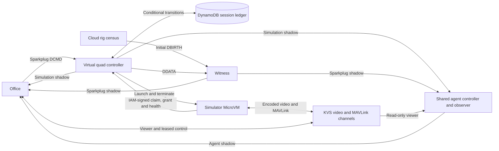

# Virtual quadcopter architecture

`virtual-quad` is a cloud rig device type. An Office operator selects an
enlisted device, starts a disposable simulator, acquires control, flies using
onboard video, lands, and stops. The existing agent joins a ready simulator
as a read-only observer. Each session starts with the same world and a fresh
disarmed aircraft. The operating and release procedures live in the
[device guide](../devices/virtual-quad/README.md).

## AWS footprint at REDCON 4

**A stopped virtual quad has a small AWS footprint and zero dedicated
runtime compute once shutdown settles.** There is no running or suspended
simulator MicroVM and no running agent observer for the device. ArduCopter,
the camera renderer, the H.264 encoder and both WebRTC masters run only
during a simulator session. The shared agent controller retires the observer
separately, so it can briefly remain in teardown after the simulator reaches
REDCON 4.

The IoT Thing and its named shadows, the two KVS signaling channel
registrations, and any terminal DynamoDB session record remain available
for discovery and the next start. The MicroVM image snapshot and release
artifacts are stored for reuse. The environment's shared cloud-rig census
and repair Lambdas still run on their schedules, and an open Office page
reads status. The rig census announces the stopped device through
Sparkplug, so it appears in Office and can receive a Start command while
its rig is awake. [Cloud-rig census](../devices/cloud-mcu/lambda/internal/cloudmcu/cloudmcu.go)
· [Simulator repair](../devices/virtual-quad/lambda/internal/controller/handler.go)
· [Agent controller](components/agent.md#controller-and-authorization)

## Component ownership

| Component | Authority and dependencies |
| --- | --- |
| Device catalog | The device [manifest](../devices/virtual-quad/manifest.toml) declares its registered type, compatible rig, REDCON levels, shadow schemas/defaults, channel names and Office adapter. The shared [type catalog](../shared/aws/python/src/aws/type_catalog.py) and [enlist handler](../shared/aws/python/src/aws_admin/enlist_txing.py) register that declaration and provision per-device channels and shadow defaults. |
| Cloud rig | The [cloud rig census](../devices/cloud-mcu/lambda/internal/cloudmcu/cloudmcu.go) announces the rig and publishes the initial virtual device DBIRTH. Its cloud-MCU tick path serves that device type. The rig's born REDCON 1 projection authorizes new simulator sessions. |
| Session controller | The device [Go Lambda](../devices/virtual-quad/lambda/) validates registry assignments and handles REDCON commands, worker requests and repair. The DynamoDB session ledger owns reservations, grants, deadlines and launch identity. The controller writes the `simulation` shadow and publishes Sparkplug metrics. |
| Witness | The shared [Sparkplug projector](../witness/) owns operational writes to the `sparkplug` shadow. It validates virtual-quad assignment and orders device events by report timestamp using version-conditional writes. |
| Simulator | The [runtime](../devices/virtual-quad/runtime/) owns the MicroVM hooks, supervisor, pinned ArduCopter SITL, pose camera, encoder, native KVS bridge and flight lease. The supervisor claims a session and reports health to the controller. The runtime uses the shared [native KVS transport](../devices/common/board/kvs_master/) and generated MAVLink headers. |
| Office | The [device adapter](../devices/virtual-quad/web/virtual-quad-adapter.tsx) owns session-specific views, readiness, command correlation and browser flight policy. Office owns authentication, shared route navigation, REDCON presentation, notification delivery, shadow reads, KVS viewer transport and MAVLink framing. |
| Agent | The existing [agent controller and runtime](components/agent.md#profiles-and-lifecycle) own observer lifecycle, media consumption and the `agent` shadow. The simulation session identity fences that observer's activation. |

The IoT registry is authoritative for assignment. The per-device signaling
channels `<device-id>-board-video` and `<device-id>-mavlink` persist across
sessions. Enlistment seeds all five shadows. `mavlink` and `video` carry the
registered capability defaults shared with the current catalog model.
The simulator's live service and link state are the fenced Sparkplug
projection and the connected WebRTC peers. It publishes no retained media
descriptors or status topics. The media schemas preserve the enlisted shapes.
The default and fixture documents are examples of those shapes. Operational
availability and flight ownership are read from the sources in the table.

## Hosting and runtime

The simulator uses a dedicated Linux ARM64 Lambda MicroVM image in
`eu-central-1`, with at least 4 GiB of memory. Each session restores a fresh
VM from an explicit active image version. It uses managed Internet egress,
`NO_INGRESS`, and a scoped execution role for the virtual-quad KVS channel namespace and
IAM-authenticated controller URL. The supervisor derives channel names from
the validated device assignment. The simulator and agent use separate image
and execution resources. The controller is a short-lived
`provided.al2023` Lambda with an independent one-minute EventBridge Scheduler
repair pass. [AWS MicroVM images](https://docs.aws.amazon.com/lambda/latest/dg/microvms-images.html)
· [AWS Lambda boundary](aws-lambda-boundary.md)

The snapshot contains the packaged programs and an idle lifecycle hook
listener. On restore, the `/run` hook validates the MicroVM ID and assignment
and obtains short-lived AWS credentials. It starts children only after the
controller grants the current session. Each run has new scratch and wipes
SITL state. The supervisor polls grants every two seconds and reports
health every five. The `/terminate` hook cancels the workload, gives the media
process time to close its write gate and request LAND, and reaps both
process groups. The platform duration and the session ledger bound cleanup
when a process or hook fails. [MicroVM lifecycle](https://docs.aws.amazon.com/lambda/latest/dg/microvms-launching.html)

ArduCopter's built-in quad model owns dynamics, navigation, sensors and
ground contact. The worker binds MAVLink to loopback, receives truth pose via
`SIM_STATE` at about 30 Hz, converts it into local coordinates, and
interpolates pose on a monotonic timeline. The fixed forward camera looks
slightly down over a landing pad, floor markings and landmark walls. Walls
and props are visual geometry. The CPU renderer feeds a bounded GStreamer
x264 pipeline, producing 640 × 360 at 15 fps, about 800 kbps, constrained
baseline H.264, with a keyframe every second. The shared KVS sender takes
encoded access units and isolates video peers so slow viewers do not stall
SITL. [Native camera](../devices/virtual-quad/runtime/camera.cpp)
· [Board video transport](components/board-video.md)

## Session lifecycle and readiness

### Startup sequence

1. **REDCON 4 → 3 — reserve and launch.** The operator selects REDCON 1
   in Office. The session controller receives the Sparkplug command,
   verifies the current device assignment, awake rig and terminal revision,
   reserves one session in DynamoDB, and requests a new MicroVM from the
   pinned simulator image. REDCON 3 indicates startup is in progress.
2. **Activate the simulator inside the MicroVM.** The restored supervisor
   accepts the run hook and claims the current session from the controller.
   After the claim is granted, it starts fresh ArduCopter SITL and the media
   worker. The worker starts both KVS masters and the camera encoder during
   this same startup. The REDCON levels reflect which services have passed
   their readiness checks. The device can go directly from REDCON 3 to 1 if
   the first ready health report confirms both services.
3. **REDCON 2 — expose MAVLink.** The controller receives fresh health
   showing a SITL heartbeat and connected KVS MAVLink signaling. Office can
   open the separate MAVLink peer for read-only telemetry. The browser
   reports MAVLink live after it receives a heartbeat.
4. **REDCON 1 — expose the camera and enable flight control.** The controller
   also requires healthy navigation, fresh simulator pose, recent encoded
   camera frames including an initial keyframe, and connected KVS video
   signaling. It marks the session operational, and Office opens the camera
   viewer after observing the matching Sparkplug and simulation reports.
   The operator can acquire an available flight lease once the browser has
   fresh telemetry and decoded video.
5. **Start the optional read-only observer.** Fresh operational REDCON 1
   makes the device eligible for agent observation. When cloud agent
   automation is enabled, the agent controller verifies that readiness and
   starts a separate MicroVM for the same session. The observer connects to
   both KVS streams independently of Office flight control.

[Command and health handling](../devices/virtual-quad/lambda/internal/controller/handler.go)
· [Session readiness](../devices/virtual-quad/lambda/internal/lifecycle/record.go)
· [Media worker](../devices/virtual-quad/runtime/media.cpp)
· [Agent observation](#agent-observation)

| Phase | REDCON | Evidence and behavior |
| --- | --- | --- |
| Stopped or terminal failure | 4 | The device is born with Sparkplug and simulation available. No simulator or observer compute is required. A previous failure carries its outcome and reason. |
| Starting | 3 or 2 | The reservation is current. Fresh SITL heartbeat and MAVLink master readiness permit REDCON 2 and observation. |
| Operational | 1, with 2 or 3 during readiness loss | REDCON 1 requires heartbeat and MAVLink master plus navigation, fresh pose, encoded camera and ready video master. Agent eligibility follows fresh operational REDCON 1. |
| Stopping | 3 | External flight authority is withdrawn. The controller retains the reservation until termination or definitive launch failure. |

Commands are Sparkplug `DCMD.redcon` with levels 1 and 4. A UUID
`virtualQuad.requestId` correlates the result. Start carries the observed
`virtualQuad.terminalRevision` as a decimal string and Stop carries the active
`virtualQuad.sessionId`, including during startup. DynamoDB conditional writes
fence the request, registry assignment, worker claim and observed health.
The launch uses the session ID as its idempotency key and records exact
inputs before dispatch. A retry sends those inputs, including its image version
and absolute lifetime budget. A competing VM cannot acquire the existing
claim. The repair pass reconciles unresolved reservations and managed image
inventory. [Lifecycle implementation](../devices/virtual-quad/lambda/internal/lifecycle/)
· [Sparkplug lifecycle](sparkplug-lifecycle.md)

Startup has a 90-second deadline. An operational session receives up to
12 minutes of flight authority within the 840-second total budget, with up
to 30 seconds reserved for shutdown. Health expires after 15 seconds. A live
worker with healthy SITL can recover its media masters within 30 seconds of
a readiness loss. Stop records revocation, requests termination and checks
for terminal state. Repair retries unresolved cleanup and republishes the
terminal projection. The simulator, browser and agent each reject stale
session generations.

The simulation shadow carries phase, deadlines, terminal revision, last
outcome and an availability watermark and expiry. Readiness requires a born
Sparkplug projection for the same session at or ahead of that watermark,
before the expiry. This joins two asynchronous shadows without treating a
delayed media flag as current. The browser can conservatively withdraw
readiness when it has no fresh matching view. REDCON 4 represents a reachable
stopped device. DDEATH is used for device management unavailability.

## Office and flight authority

The device adapter submits the correlated command through Office's shared
Sparkplug publishing and supplies lifecycle messages to the standard
notification tray and Session Log. It presents session deadlines and uses
the shared video panel and a separate MAVLink viewer. The MAVLink indicator
on the device detail route distinguishes service availability from a live
browser heartbeat. The rig catalog applies the same session freshness check
and reports service availability. The agent indicator reads the actual agent
shadow and requires a matching live observer for the current ready session.

The MAVLink path uses the ordered, reliable `txing.mavlink.v1` data channel,
one complete MAVLink 2 frame per binary message and the common JSON lease
operations. The simulator owns lease arbitration and the loopback write
gate inside the media worker. Viewers start read-only.
The browser enables flight commands with fresh telemetry and decoded video.
The simulator additionally verifies readiness, peer identity, lease epoch,
MAVLink target and allowed commands before forwarding. The operator takes
off through Guided mode and normal ArduCopter arm checks. Movement uses
bounded Guided setpoints. Releasing inputs requests hover. Release, peer
loss, lease expiry, media loss or Stop revoke writes and request LAND when
the aircraft may be airborne. Only the active controller can send writable
commands. [Flight authority implementation](../devices/virtual-quad/runtime/flight.cpp)
· [Shared MAVLink wire contract](contracts/board-mavlink.md)
· [Office operation](../devices/virtual-quad/README.md#flight-in-office)

## Agent observation

Fresh operational readiness enables the existing agent's virtual-quad
profile. Its activation ID is the simulation session ID, with a deadline
limited by the earlier of the flight cutoff and the agent budget. The agent
consumes the two channels through KVS TURN and rejects lease acquisition and
outgoing MAVLink. On readiness loss, expiry, a stopped session or a
replacement session, it closes its peers and the controller retires the run.
Agent health is diagnostic and independent of simulator readiness.
[Agent shadow contract](contracts/agent-shadow.md)
· [Agent profiles](components/agent.md#profiles-and-lifecycle)

## Release and verification

The runtime, controller Lambda, Office and observer have distinct immutable
release identities. The device guide links their compatibility and build
evidence to the pinned simulator image.
[Image publication, deployment and rollback](../devices/virtual-quad/README.md#build-and-publish-the-session-image)

Review source ownership, build inputs and shadow contracts before the live
checks on the permanent device. Use local native and Go tests for authority,
lifecycle and failure paths, and Office tests for adapter and command
behavior. The live acceptance covers discovery, bounded startup, camera and
MAVLink, exclusive control and manual flight, observer media, loss recovery,
timeout and fresh restart. It also covers the mixed cloud rig and applicable
existing device regression checks. The device guide owns the operator
procedure. [Runtime evidence](https://github.com/mparkachov/txing/issues/176)
· [Prior acceptance and operator-approved skips](https://github.com/mparkachov/txing/issues/182)
· [Consolidation and permanent deployment](https://github.com/mparkachov/txing/issues/183)
