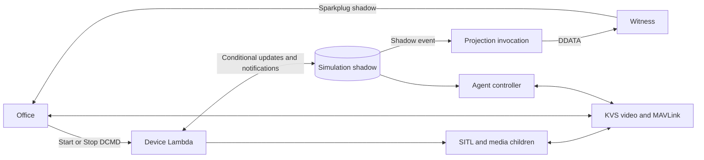

# Virtual quadcopter architecture

`virtual-quad` is a cloud rig device type. An Office operator selects an
enlisted device, starts a disposable simulator, acquires control, flies using
onboard video, lands, and stops. The shared agent joins a ready simulator as
an observer and can acquire a manual control lease on request. Each session
starts with the same world and a fresh
disarmed aircraft. The operating and release procedures live in the
[device guide](../devices/virtual-quad/README.md).

## AWS footprint at REDCON 4

A stopped virtual quad has no dedicated running simulator or observer compute,
provisioned simulator concurrency, or simulator repair schedule. The Thing,
named shadows, signaling channels, release artifacts and logs remain. The
shared cloud rig census and agent controller retain their existing roles. KVS
can charge for signaling channels used earlier in the billing month.

## Component ownership

| Component | Responsibility |
| --- | --- |
| Cloud rig | Announces the enlisted device and authorizes Start when awake. |
| Device Lambda | Validates commands and conditionally updates the `simulation` shadow. The accepted Start invocation owns the simulator children and their health reports. |
| `simulation` shadow | Holds the session identity, owner, deadlines, readiness and correlated command result. Its version fences competing changes. |
| Witness | Projects committed Sparkplug DDATA into the `sparkplug` shadow. |
| Simulator | ArduCopter SITL and the media worker provide the camera, MAVLink and exclusive flight lease. |
| Office and agent | Consume the matching readiness projection and connect to the existing KVS channels. The agent retains its independent lifecycle. |

## Hosting and runtime

The Frankfurt ARM64 `provided.al2023` function uses the shared Lambda release
ZIP, which contains the bootstrap, supervisor, native simulator and media
dependencies. A Start invocation creates fresh scratch space, launches a wiped
and disarmed SITL, and owns both children. Lambda is configured for 900 seconds
and 3008 MiB. There is no simulator MicroVM, DynamoDB ledger, worker URL, grant
loop or recurring simulator repair invocation. The shared agent's hosting is
unchanged. [Lambda release boundary](aws-lambda-boundary.md)

ArduCopter owns dynamics, navigation, sensors and ground contact. The media
worker renders the truth pose into 640 × 360 video at 15 fps and shares the
native KVS sender for video and MAVLink. The simulator's per-device signaling
channels survive sessions. [Native camera](../devices/virtual-quad/runtime/camera.cpp)
· [Board video transport](components/board-video.md)

## Session lifecycle and readiness

Start and Stop use Sparkplug `DCMD.redcon` with the existing command UUID.
Start includes the observed terminal revision; Stop names the active session.
An awake rig and current assignment are required for Start. The Start
invocation accepts one command using a version-conditional `simulation` shadow
write before launching anything. A competing invocation cannot acquire that
session, and an earlier command or invocation cannot finish its replacement.

The supervisor reports local health every five seconds. A fresh heartbeat
makes simulation available; MAVLink signaling permits REDCON 2. Healthy
navigation, video and MAVLink make the session operational at REDCON 1 and
allow Office and the agent to connect. Health expires after 15 seconds; with
healthy SITL, media recovery has a 30-second bound. Committed simulation changes
trigger a separate projection invocation, which publishes DDATA for Witness.
The availability watermark and expiry fence older reports in both consumers.

Startup is bounded to 90 seconds, flight to 12 minutes and cleanup to 30
seconds inside the 900-second Lambda timeout. Stop changes the matching
session to `stopping`; the owner receives an IoT MQTT shadow notification,
closes the flight write gate, requests LAND if needed, reaps its children and
records REDCON 4. The owner reads the rig and simulation shadows after each
subscription, including reconnection, to catch changes missed while offline.
It pauses health renewal during a disconnect and allows up to ten seconds to
reconnect, bounded by the last readiness expiry. If recovery fails, the
workload shuts down. A rig sleep or changed assignment also stops the session.

An asynchronous Lambda failure destination emits an EventBridge event whose
request ID can finalize only the invocation that owned the session. If that
event is lost, readiness expires and Office can issue a fresh Start after the
recorded invocation hard deadline. [Session implementation](../devices/virtual-quad/lambda/internal/session/)
· [Sparkplug lifecycle](sparkplug-lifecycle.md)

## Office and flight authority

The device adapter submits the correlated command through Office's shared
Sparkplug publishing and records lifecycle messages in the Session Log.
Failures also appear in the notification tray. It presents session deadlines and uses
the shared video panel and a separate MAVLink viewer. The rig catalog and
device header report service availability from the Sparkplug shadow. The
video overlay reports the browser's MAVLink heartbeat. Both routes apply the
session freshness check to REDCON. The agent indicator reads the actual agent
shadow and requires a matching live observer for the current ready session.

The MAVLink path uses the ordered, reliable `txing.mavlink.v1` data channel,
one complete MAVLink 2 frame per binary message and the common JSON lease
operations. The simulator owns lease arbitration and the loopback write
gate inside the media worker. Viewers start read-only.
The browser enables flight commands with fresh telemetry and decoded video.
The simulator bridge verifies readiness, peer identity, and lease epoch
before forwarding complete MAVLink 2 frames byte for byte to loopback SITL.
ArduCopter validates the frames and their commands. Office takes off through
Guided mode and normal ArduCopter arm checks, sends bounded velocity setpoints,
and requests hover when the controls center. The simulator requests EKF status
at 5 Hz to keep navigation health current during ArduCopter parameter transfers.
Release, peer loss, lease expiry,
media loss or Stop revoke writes and request LAND when the aircraft may be
airborne. Before granting another lease, the bridge waits for landed and
disarmed telemetry if it needs to confirm the effects of recent uplink.
[Flight authority implementation](../devices/virtual-quad/runtime/flight.cpp)
· [Shared MAVLink wire contract](contracts/board-mavlink.md)
· [Office operation](../devices/virtual-quad/README.md#flight-in-office)

## Agent observation

Fresh operational readiness enables the existing agent's virtual-quad
profile. Its activation ID is the simulation session ID, with a deadline
limited by the earlier of the flight cutoff and the agent budget. The agent
consumes the two channels through KVS TURN. An explicit `--control` request
can acquire a free lease using the same operator path as TBot. The current
lease holder keeps control until release or revocation. On readiness loss,
expiry, a stopped session or a
replacement session, it closes its peers and the controller retires the run.
Agent health is diagnostic and independent of simulator readiness.
[Agent shadow contract](contracts/agent-shadow.md)
· [Agent profiles](components/agent.md#profiles-and-lifecycle)

## Release and verification

Build and publish the shared Lambda release, then apply the device stack in a
single REDCON 4 maintenance window. The [device guide](../devices/virtual-quad/README.md#build-and-publish-the-session-lambda)
owns packaging, qualification, cutover, rollback and live acceptance. The
permanent Thing and signaling channels remain in place.
